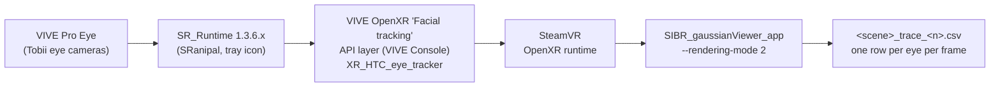

# 0. Overview: how it works, and what used to go wrong

## Data path

The viewer gets head poses and eye gaze through **OpenXR**. With a VIVE Pro Eye on SteamVR, the eye data does **not** come from SteamVR itself:

- an **OpenXR API layer** installed by *VIVE Console for SteamVR* reads **SRanipal**, HTC's eye-tracking runtime;
- it exposes that data through the HTC extension `XR_HTC_eye_tracker`: per-eye gaze, pupil and eye openness.

Each rendered frame, the viewer writes **two CSV rows, left eye then right eye**. They contain the eye poses, the field of view, the gaze, timestamps and validity flags.

## Eye-tracking backends

The viewer picks the eye-tracking API automatically, in this order of preference:

| Backend (`GazeSource` column) | OpenXR extension | Devices | Data |
|---|---|---|---|
| `FB_eye_tracking_social` | `XR_FB_eye_tracking_social` | Meta Quest Pro (Quest Link) | per-eye gaze; the original EyeNavGS dataset |
| `HTC_eye_tracker` | `XR_HTC_eye_tracker` | **HTC VIVE Pro Eye** (SteamVR + VIVE Console) | per-eye gaze, pupil diameter/position, eye openness |
| `EXT_eye_gaze_interaction` | `XR_EXT_eye_gaze_interaction` | Varjo, Pico, HP Omnicept, ... | one combined gaze, copied to both eye rows |
| `none` | – | anything else | gaze columns = identity, `GazeValid=0` |

You can force a backend with the environment variable `EYENAVGS_EYE_TRACKING=fb|htc|ext|none`, or with `-EyeTracking` in the launcher script.

## What used to go wrong

The original EyeNavGS code was written for the Meta Quest Pro. Getting it to record a VIVE Pro Eye's gaze on a current PC hit the problems below. All of them are fixed in this repository, or handled by its scripts:

| # | Problem | Effect | Fix |
|---|---|---|---|
| 1 | The code only implemented `XR_FB_eye_tracking_social` (Quest Pro). | With a VIVE, gaze columns were always `0,0,0,1`. | New `XR_HTC_eye_tracker` and `XR_EXT_eye_gaze_interaction` backends. |
| 2 | The VIVE eye-tracking OpenXR layer is **disabled** by default in SteamVR (*Settings > OpenXR > Manage OpenXR API layers*: all "No"). | No eye extension available, even with fix 1. | Enable it in SteamVR, or let the launcher enable it for the session ([step 3](03_vr_eye_tracking_setup.md#34-enable-the-vive-openxr-eye-tracking-layer)). |
| 3 | An **old standalone SRanipal 1.3.2** (2021) can be installed and registered, while VIVE Console's layer needs **1.3.6.x**. | The layer **kills the viewer** (`0xc0000409` in `ucrtbase.dll`) as soon as eye tracking starts. | Run VIVE Console's SR_Runtime 1.3.6.12 (the launcher does it, [step 3](03_vr_eye_tracking_setup.md#33-the-sranipal-version-trap)). |
| 4 | Build: CMake 4.x rejects `xatlas`; C++20 designated initializers in C++14 code; undeclared `initial_sacle`. | Configure or compile errors. | Fixed in the code. |
| 5 | Build: VS 2026 (MSVC 19.50) is not accepted by CUDA 12.x. | `nvcc`: "unsupported Microsoft Visual Studio version". | Use the v143 toolset (VS 2022 / Build Tools 2022); the build script picks it. |
| 6 | Recording bugs: gaze disabled for the whole session after one blink; values truncated to 3 decimals; a 19-column header over 24-column rows; a new session *appended* to the previous file; `znear`/`zfar` swapped; DST missing from `iso_time`. | Corrupted or ambiguous CSVs. | Fixed ([step 9](09_code_changes.md)). |

---
[← Tutorial index](README.md) · [1. Requirements →](01_requirements.md)
